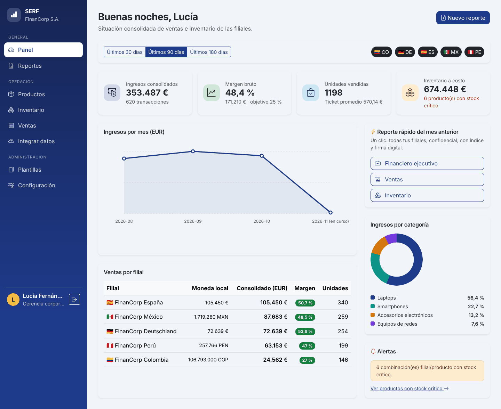
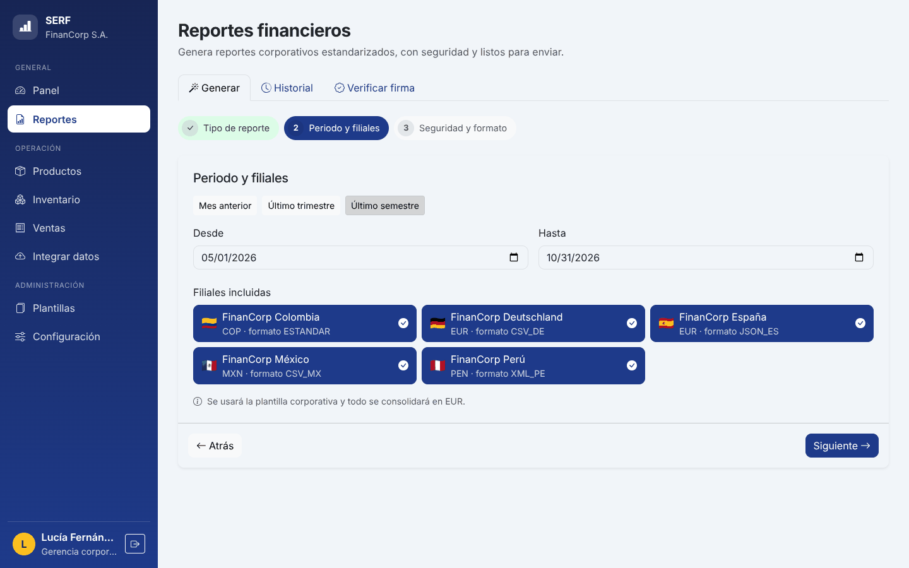
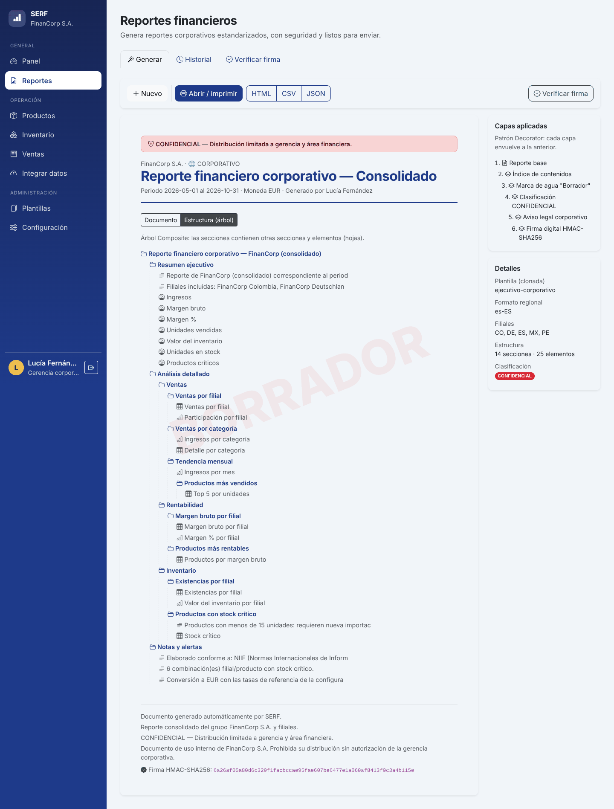
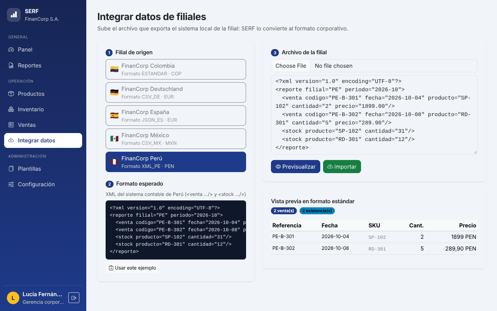
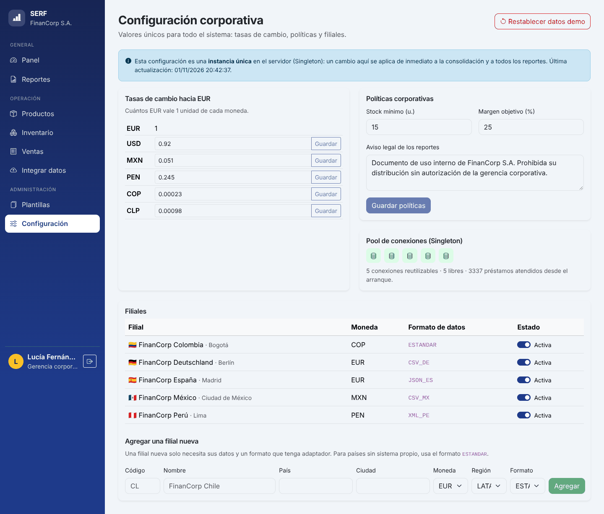
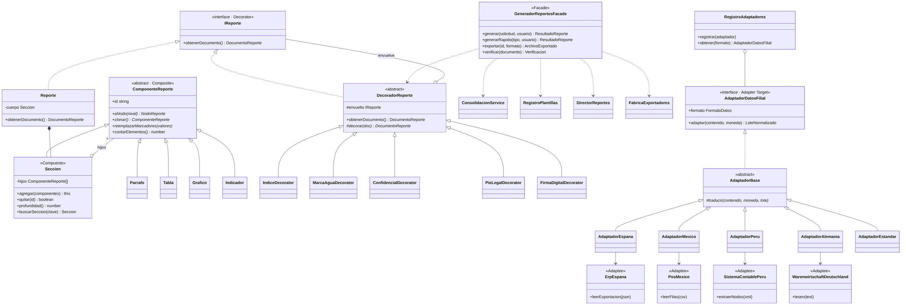

# SERF · Sistema Empresarial de Gestión de Reportes Financieros

Aplicación web para **FinanCorp S.A.** que integra las ventas e inventarios de sus filiales (España, Alemania, México, Perú y Colombia), registra los productos tecnológicos importados desde China y genera **reportes financieros corporativos automáticos, seguros y estandarizados**.

> Evaluación parcial · Unidad didáctica **Patrones de Diseño de Software** · IDAT, Escuela de Tecnología.



| | |
|---|---|
| **Integrante** | Anderson Leonel Ugaz Portales |
| **Prototipo interactivo** | https://claude.ai/artifact/SEvDNcQDCHTzC4shDhpgTM · [cómo llevarlo a Figma](docs/02-diseno-wireframes-y-prototipo.md#cómo-recrear-el-prototipo-en-figma) |
| **Tecnologías** | TypeScript · NestJS 11 (backend) · Angular 21 + Bootstrap 5 (frontend) · Jest y Vitest (pruebas) |
| **Documento de sustentación** | [`docs/SERF-Sustentacion-Tecnica.pdf`](docs/SERF-Sustentacion-Tecnica.pdf) |

---

## Contenido

1. [Funcionalidades](#funcionalidades)
2. [Patrones de diseño aplicados](#patrones-de-diseño-aplicados)
3. [Requisitos del entorno](#requisitos-del-entorno)
4. [Instalación](#instalación)
5. [Ejecución](#ejecución)
6. [Cuentas de demostración](#cuentas-de-demostración)
7. [Pruebas](#pruebas)
8. [Estructura del repositorio](#estructura-del-repositorio)
9. [API REST](#api-rest)
10. [Documentación](#documentación)
11. [Solución de problemas](#solución-de-problemas)

---

## Funcionalidades

| Requisito del caso | Qué hace SERF |
|---|---|
| **1. Integrar datos de todas las filiales** | Cada filial sube el archivo que exporta su sistema (JSON, CSV, XML o el formato del ERP alemán). SERF lo convierte al formato estándar, muestra una vista previa, omite las ventas duplicadas y actualiza el inventario. |
| **2. Registrar productos importados y seguir su venta** | Catálogo con SKU, proveedor en China, costo de importación en USD y precio de lista en EUR. Inventario por filial con alertas de stock crítico. Registro de ventas en moneda local con control de stock. |
| **3. Reportes automáticos, seguros y estandarizados** | Cuatro tipos de reporte (ejecutivo, ventas, rentabilidad, inventario), generados con un asistente de 3 pasos o con **un clic** para el cierre mensual. Incluyen índice, marca de agua, clasificación de confidencialidad, aviso legal y **firma HMAC-SHA256** verificable. Se exportan en HTML, CSV o JSON. |
| **4. Escalable y adaptable** | Las filiales nuevas se agregan desde la configuración. Las tasas de cambio, el stock mínimo, el margen objetivo y el aviso legal están centralizados y se aplican de inmediato. |

Además:
- Acceso por **roles** (gerencia, analista, operador de filial); un operador solo ve los datos de su filial.
- Contraseñas cifradas con scrypt.
- Interfaz **responsive** para escritorio y celular.

| | |
|---|---|
|  |  |
| **Asistente de reportes** | **Estructura jerárquica del reporte** |
|  |  |
| **Integración de archivos de filiales** | **Configuración centralizada** |

---

## Patrones de diseño aplicados

| Requisito complementario | Patrón | Clases principales |
|---|---|---|
| 1. Configuración centralizada usable en todo el sistema | **Singleton** | `ConfiguracionCorporativa`, `PoolConexiones` |
| 2. Reutilizar plantillas base y adaptarlas a cada país | **Prototype** | `PlantillaReporte.clonar()`, `RegistroPlantillas` |
| 3. Construir reportes complejos paso a paso | **Builder** | `ReporteBuilder` (API fluida), `SeccionBuilder`, `DirectorReportes` |
| 4. Interfaz simple para generar reportes listos para enviar | **Facade** | `GeneradorReportesFacade` |
| 5. Estructura jerárquica (secciones y subsecciones) | **Composite** | `ComponenteReporte`, `Seccion`, `Parrafo`, `Tabla`, `Grafico`, `Indicador` |
| 6. Añadir características extra sin modificar el reporte | **Decorator** | `IndiceDecorator`, `MarcaAguaDecorator`, `ConfidencialDecorator`, `PieLegalDecorator`, `FirmaDigitalDecorator` |
| Integrar los formatos distintos de cada filial | **Adapter** | `AdaptadorEspana`, `AdaptadorMexico`, `AdaptadorPeru`, `AdaptadorAlemania`, `AdaptadorEstandar` |
| Crear exportadores sin acoplarse a clases concretas | **Fábrica** | `FabricaExportadores` |

La explicación detallada, con fragmentos de código y la aplicación de **SOLID** y POO, está en [`docs/04-patrones-solid-y-poo.md`](docs/04-patrones-solid-y-poo.md). Los diagramas UML están en [`docs/uml/`](docs/uml/).



---

## Requisitos del entorno

| Herramienta | Versión | Verificar con |
|---|---|---|
| **Node.js** | 20.19 o superior (recomendado 22 LTS o 24 LTS) | `node -v` |
| **npm** | 10 o superior (viene con Node.js) | `npm -v` |
| **Git** | cualquiera reciente | `git --version` |
| Navegador | Chrome, Edge o Firefox actualizados | — |

No se necesita una base de datos: los datos se guardan en memoria y se cargan datos de demostración al iniciar.

> **Windows:** si `npm` muestra *"la ejecución de scripts está deshabilitada"*, ejecuta una vez en PowerShell `Set-ExecutionPolicy -Scope CurrentUser RemoteSigned` y responde **S**. Otra opción es usar `npm.cmd` en lugar de `npm`.

---

## Instalación

```bash
git clone https://github.com/andersonugazpor-crypto/serf-reportes-financieros.git
cd serf-reportes-financieros
npm install
```

`npm install` en la raíz instala automáticamente las dependencias del **backend** y del **frontend**. Tarda unos minutos la primera vez.

---

## Ejecución

```bash
npm start
```

Se levantan los dos proyectos a la vez:

| Servicio | URL |
|---|---|
| Interfaz web (Angular) | **http://localhost:4200** (se abre sola) |
| API REST (NestJS) | http://localhost:3000/api |

Para detenerlos, pulsa `Ctrl + C`. Si la primera vez Angular pregunta por compartir datos de uso (`y/N`), responde **N**.

Otros comandos útiles:

| Comando | Descripción |
|---|---|
| `npm run start:api` | Solo el backend |
| `npm run start:web` | Solo el frontend (necesita el backend corriendo) |
| `npm run build` | Compila ambos proyectos para producción |
| `npm test` | Ejecuta todas las pruebas |
| `npm run test:cov` | Pruebas del backend con reporte de cobertura (`backend/coverage/`) |

---

## Cuentas de demostración

| Usuario | Contraseña | Rol | Puede |
|---|---|---|---|
| `gerente` | `Gerente2026!` | Gerencia corporativa | Todo: configuración, filiales nuevas, restablecer datos |
| `analista` | `Analista2026!` | Analista financiero | Panel, reportes y catálogo de productos; configuración en solo lectura |
| `operador.pe` | `Peru2026!` | Operador de filial (Perú) | Ventas, ingresos de stock, integración y reportes **solo de Perú** |
| `operador.mx` | `Mexico2026!` | Operador de filial (México) | Lo mismo, solo de México |

La pantalla de inicio de sesión tiene botones para entrar con un clic.

### Recorrido sugerido

1. Entra como **gerente** y revisa el panel consolidado.
2. Pulsa **"Financiero ejecutivo"** en *Reporte rápido*: obtienes el reporte del mes anterior, firmado.
3. Ve a **Reportes**, elige un tipo y una filial, activa la marca de agua y genera el reporte. Cambia a **Estructura (árbol)** para ver la jerarquía.
4. Descarga el **JSON**. En la pestaña **Verificar firma**, súbelo: la firma es válida. Edita cualquier valor del JSON y vuelve a subirlo: la firma deja de ser válida.
5. Ve a **Integrar datos**, elige *FinanCorp Perú*, pulsa *Usar este ejemplo* → *Previsualizar* → *Importar*. Importa de nuevo para ver que no se duplican las ventas.
6. En **Configuración**, cambia la tasa del MXN y vuelve al panel: los montos de México cambian (Singleton). Agrega una filial nueva, por ejemplo Chile con formato `ESTANDAR`.

---

## Pruebas

```bash
npm test               # backend + frontend
npm run test:backend   # 71 pruebas (Jest): 54 unitarias de patrones y dominio + 17 e2e de la API
npm run test:frontend  # 6 pruebas (Vitest): pipe, gráfico, árbol recursivo y sesión
npm run test:cov       # cobertura del backend
```

**Resultados**

| Suite | Pruebas | Qué verifica |
|---|---|---|
| `backend/test/unit/singleton.spec.ts` | 11 | Instancia única, constructor privado, validaciones, vista inmutable, pool (préstamo, agotamiento, liberación ante errores) |
| `backend/test/unit/composite-prototype.spec.ts` | 12 | Conteo uniforme, 25 niveles de anidamiento, ciclos, marcadores; clonación profunda e independiente, variantes por país |
| `backend/test/unit/builder-decorator.spec.ts` | 15 | API fluida, pasos obligatorios, plantilla intacta, recetas del Director; capas apiladas, índice numerado, firma que detecta alteraciones; exportadores |
| `backend/test/unit/adapter-dominio.spec.ts` | 16 | Los 5 adaptadores, fechas y decimales locales, filas inválidas; encapsulamiento de `Dinero`, `Producto`, `Stock`, `Venta` y `Filial` |
| `backend/test/e2e/api.e2e.spec.ts` | 17 | Seguridad y roles, alcance por filial, venta sin stock, importación sin duplicados, filial nueva, reportes por la fachada, verificación de firma, cambio de tasa |
| `frontend/src/app/app.spec.ts` | 6 | Formato de cifras, gráfico de barras, renderizado recursivo del Composite, sesión y roles |

```text
Test Suites: 5 passed, 5 total
Tests:       71 passed, 71 total        (backend · cobertura de líneas 92 %)
Test Files:  1 passed (1)
Tests:       6 passed (6)               (frontend)
```

Las **pruebas de usabilidad** con usuarios simulados, los problemas detectados y las mejoras aplicadas están en [`docs/03-pruebas-de-usabilidad.md`](docs/03-pruebas-de-usabilidad.md).

Cada *push* ejecuta las pruebas y la compilación en **GitHub Actions** (`.github/workflows/ci.yml`).

---

## Estructura del repositorio

```text
serf-reportes-financieros/
├── backend/                         API REST · NestJS + TypeScript
│   ├── src/
│   │   ├── comun/                   Entidad base, Dinero, errores, tokens de inyección
│   │   ├── configuracion/           ⟵ Singleton: ConfiguracionCorporativa
│   │   ├── infraestructura/
│   │   │   └── persistencia/        ⟵ Singleton: PoolConexiones · Repositorio<T>
│   │   ├── auth/                    Login, roles, guard global
│   │   ├── filiales/
│   │   │   ├── adaptadores/         ⟵ Adapter: un adaptador por formato
│   │   │   └── sistemas-externos/   Sistemas locales de cada filial (adaptees)
│   │   ├── productos/  inventario/  ventas/
│   │   ├── reportes/
│   │   │   ├── composite/           ⟵ Composite: Seccion y hojas
│   │   │   ├── prototype/           ⟵ Prototype: plantillas y registro
│   │   │   ├── builder/             ⟵ Builder: ReporteBuilder + Director
│   │   │   ├── decorator/           ⟵ Decorator: capas del reporte y firma
│   │   │   ├── exportacion/         Fábrica de exportadores (HTML, CSV, JSON)
│   │   │   ├── consolidacion/       Cifras unificadas en EUR
│   │   │   └── fachada/             ⟵ Facade: GeneradorReportesFacade
│   │   └── datos-demo/              Datos de ejemplo
│   └── test/
│       ├── unit/                    Pruebas unitarias por patrón
│       └── e2e/                     Pruebas de integración de la API
├── frontend/                        Interfaz web · Angular 21 + Bootstrap 5
│   └── src/app/
│       ├── core/                    API, sesión, interceptores, modelos
│       ├── layout/                  Barra lateral y menú móvil
│       ├── shared/                  Gráficos, árbol recursivo del reporte, UI
│       └── pages/                   Panel, Reportes, Productos, Inventario, Ventas…
├── docs/
│   ├── 01-definicion-del-problema.md
│   ├── 02-diseno-wireframes-y-prototipo.md
│   ├── 03-pruebas-de-usabilidad.md
│   ├── 04-patrones-solid-y-poo.md
│   ├── SERF-Sustentacion-Tecnica.pdf
│   ├── uml/                         Diagramas (PNG + fuente Mermaid)
│   ├── wireframes/                  Wireframes de escritorio y móvil
│   ├── prototipo/                   Prototipo navegable (HTML)
│   ├── capturas/                    Capturas de la aplicación
│   └── pruebas-usabilidad/          Guion de pruebas con usuarios simulados
├── .github/workflows/ci.yml         Integración continua
└── package.json                     Scripts para instalar, ejecutar y probar todo
```

---

## API REST

Todas las rutas usan el prefijo `/api` y, salvo el login, requieren el encabezado `Authorization: Bearer <token>`.

| Método | Ruta | Descripción | Roles |
|---|---|---|---|
| POST | `/auth/login` | Inicia sesión y devuelve el token | Público |
| GET | `/panel?desde&hasta&filiales` | Datos consolidados para el panel | Todos |
| GET / POST | `/productos` | Lista o registra productos importados | POST: Admin, Analista |
| GET / POST | `/inventario`, `/inventario/ingresos` | Existencias e ingreso de mercadería | POST: Admin, Filial |
| GET / POST | `/ventas` | Lista o registra ventas | POST: Admin, Filial |
| POST | `/ventas/importar/previsualizar`, `/ventas/importar` | Integra el archivo de una filial (Adapter) | Admin, Filial |
| POST | `/reportes` | Genera un reporte (Facade) | Todos (alcance por filial) |
| POST | `/reportes/rapido` | Reporte del mes anterior con un parámetro | Todos |
| GET | `/reportes/:id/descargar?formato=HTML\|CSV\|JSON` | Descarga | Todos |
| POST | `/reportes/verificar` | Verifica la firma de un documento | Todos |
| GET | `/reportes/plantillas` | Plantillas base y variantes por país | Todos |
| GET / PATCH | `/configuracion`, `/configuracion/tasas/:moneda`, `/configuracion/politicas` | Configuración central (Singleton) | PATCH: Admin |
| GET / POST | `/filiales`, `/filiales/formatos` | Filiales y formatos soportados | POST: Admin |

---

## Documentación

| Documento | Contenido |
|---|---|
| [01 · Definición del problema](docs/01-definicion-del-problema.md) | Necesidades de los usuarios y procesos donde se aplican los patrones |
| [02 · Wireframes y prototipo](docs/02-diseno-wireframes-y-prototipo.md) | Wireframes de escritorio y móvil, mapa de navegación, guía para Figma |
| [03 · Pruebas de usabilidad](docs/03-pruebas-de-usabilidad.md) | Tareas, resultados, problemas detectados y mejoras |
| [04 · Patrones, SOLID y POO](docs/04-patrones-solid-y-poo.md) | Explicación con código y diagramas UML |
| [Sustentación técnica (PDF)](docs/SERF-Sustentacion-Tecnica.pdf) | Documento para entregar en EVA |

---

## Solución de problemas

| Síntoma | Solución |
|---|---|
| `npm` no se reconoce | Instala Node.js LTS desde nodejs.org y **reinicia VS Code o la PC**. |
| *Ejecución de scripts deshabilitada* (Windows) | `Set-ExecutionPolicy -Scope CurrentUser RemoteSigned`, o usa `npm.cmd`. |
| `EADDRINUSE: port 3000` o `4200` | Ya hay otra instancia corriendo; ciérrala con `Ctrl + C` o reinicia la terminal. |
| La web dice *No se pudo conectar con la API* | El backend no está corriendo: usa `npm start` (no solo `start:web`). |
| Errores de tipos extraños tras `npm install` | La instalación quedó incompleta (antivirus o ruta muy larga). Mueve el proyecto a una ruta corta como `C:\proyectos`, borra las carpetas `node_modules` y repite `npm install`. |
| Los cambios desaparecen al reiniciar | Es lo esperado: los datos viven en memoria y se recargan los de demostración. |

---

Proyecto académico · IDAT 2026 · Anderson Leonel Ugaz Portales
