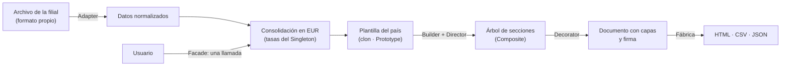

# 01 · Definición del problema y necesidades

## Contexto

**FinanCorp S.A.** importa productos tecnológicos fabricados en China (laptops, smartphones, accesorios y equipos de redes) y los vende a través de filiales en Europa y Latinoamérica. La sede central está en Madrid. Cada filial administra su propio inventario y sus ventas con un sistema distinto, pero la gerencia corporativa necesita reportes financieros unificados para tomar decisiones.

| Problema actual | Consecuencia |
|---|---|
| Cada país maneja sus datos en un formato y sistema diferente (JSON, CSV, XML, ERP alemán). | No se pueden comparar cifras sin una conversión manual. |
| La consolidación mensual exige varias validaciones manuales. | Retrasos, errores de digitación y de tipo de cambio. |
| No existe un flujo automático para generar reportes corporativos. | Cada reporte se arma a mano, con formatos distintos y sin control de integridad. |

## Usuarios y necesidades

| Usuario | Necesidades principales | Cómo las cubre SERF |
|---|---|---|
| **Gerencia corporativa** (rol `ADMIN`) | Ver la situación consolidada, generar reportes confiables y ajustar políticas. | Panel consolidado en EUR, reportes firmados, configuración central de tasas y políticas, alta de filiales. |
| **Analista financiero** (`ANALISTA`) | Analizar ventas, márgenes e inventario; mantener el catálogo. | Generador de reportes por tipo y periodo, catálogo de productos, plantillas por país. |
| **Operador de filial** (`FILIAL`) | Cargar los datos de su sistema local, registrar ventas e ingresos de mercadería. | Integración por archivo con vista previa, registro de ventas con control de stock; solo ve su filial. |

## Requisitos funcionales y su solución

| # | Requisito del caso | Funcionalidad en SERF |
|---|---|---|
| R1 | Integrar ventas e inventarios de todas las filiales. | Módulo **Integrar datos**: cada filial sube el archivo de su sistema; un adaptador lo convierte al formato estándar y evita duplicados. |
| R2 | Registrar productos importados y seguir su venta. | Módulos **Productos** (SKU, proveedor en China, costo en USD, precio en EUR), **Inventario** y **Ventas**. |
| R3 | Generar reportes automáticos, seguros y estandarizados. | **Reportes**: asistente de 3 pasos o reporte rápido de un clic; HTML/CSV/JSON con clasificación y firma HMAC-SHA256. |
| R4 | Ser escalable y adaptable a nuevas filiales o políticas. | Alta de filiales desde la configuración; formatos nuevos se agregan registrando un adaptador; políticas y tasas centralizadas. |

| # | Requisito complementario | Patrón aplicado |
|---|---|---|
| C1 | Configuración centralizada usable en todo el sistema. | **Singleton** (`ConfiguracionCorporativa`, `PoolConexiones`) |
| C2 | Reutilizar plantillas base y adaptarlas a cada país. | **Prototype** (`PlantillaReporte.clonar()`, `RegistroPlantillas`) |
| C3 | Construir reportes complejos paso a paso. | **Builder** (`ReporteBuilder` fluido + `DirectorReportes`) |
| C4 | Interfaz simple para generar reportes listos para enviar. | **Facade** (`GeneradorReportesFacade`) |
| C5 | Estructura jerárquica (secciones y subsecciones). | **Composite** (`Seccion` y hojas) |
| C6 | Añadir características extra sin modificar la estructura. | **Decorator** (índice, marca de agua, confidencialidad, aviso legal, firma) |

## Procesos donde se aplican patrones de diseño

1. **Integración de datos:** los formatos incompatibles de cada sistema local se resuelven con **Adapter**.
2. **Parámetros comunes** (tasas, stock mínimo, margen objetivo, secreto de firma, tamaño del pool): un único punto con **Singleton**.
3. **Plantillas por país:** se clonan las plantillas base con **Prototype** en lugar de escribir una por país.
4. **Armado del reporte:** **Builder** separa los pasos de construcción del producto final, y el **Director** fija la receta estándar de cada tipo.
5. **Contenido jerárquico:** con **Composite**, secciones y elementos se tratan igual (contar, clonar, serializar, reemplazar marcadores).
6. **Seguridad y extras:** con **Decorator** se apilan capas sin tocar el reporte base.
7. **Uso simple:** con **Facade**, el controlador hace una sola llamada para obtener el reporte terminado.
