# 02 · Wireframes y prototipo interactivo

## Prototipo navegable

- **Prototipo en Figma:** https://www.figma.com/design/qZo7vqocsxK4J7az6jBP6d/SERF?node-id=1002-25&t=6uQu6qEmF4cVJNUX-1
  - Modo presentación: https://www.figma.com/proto/qZo7vqocsxK4J7az6jBP6d/SERF
  - Flujo principal de 6 pantallas: inicio de sesión → panel → reporte paso 1 → paso 2 → paso 3 → reporte generado.
- **Prototipo interactivo (enlace compartible):** https://claude.ai/artifact/SEvDNcQDCHTzC4shDhpgTM
- **Archivo fuente:** [`prototipo/index.html`](prototipo/index.html). Se abre en cualquier navegador, sin instalar nada.
- **Funciones:** 10 pantallas enlazadas, cambio entre vista **escritorio** y **móvil**, opción "Mostrar zonas clicables" y notas de diseño con el patrón que usa cada pantalla.

> **Figma.** El enlace de arriba es el prototipo en Figma, armado con las imágenes de esta carpeta. Al final están los pasos que se siguieron para crearlo.

## Wireframes (escritorio)

| | |
|---|---|
| 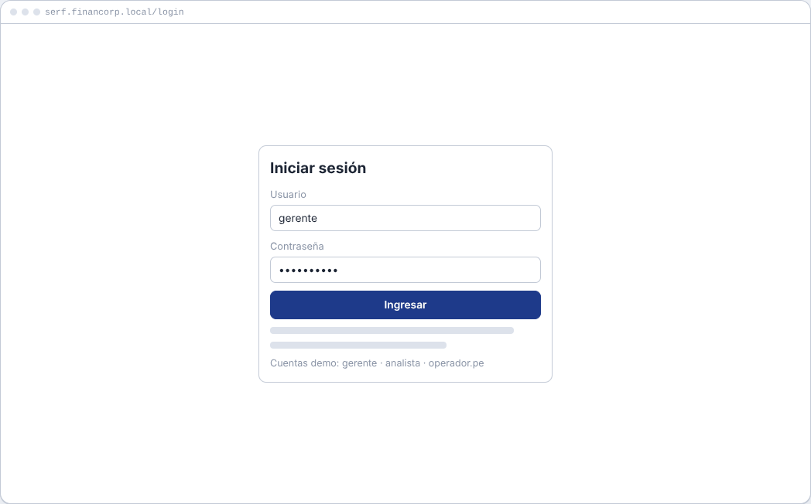 | 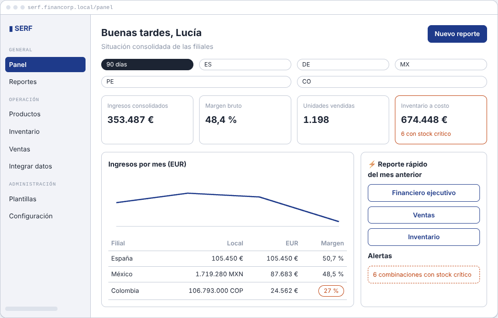 |
| **1. Inicio de sesión** | **2. Panel consolidado** |
| 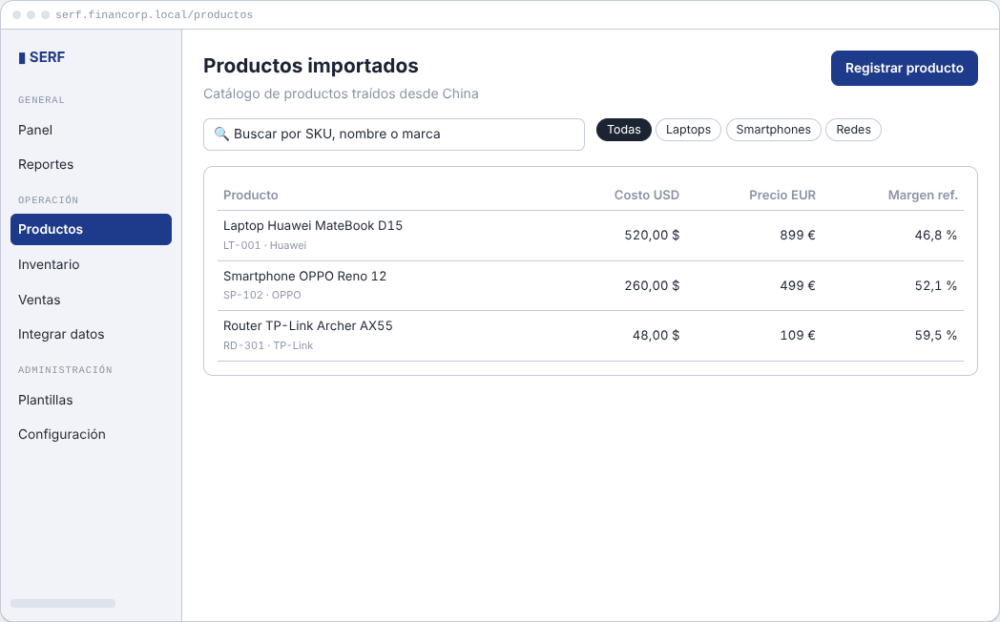 | 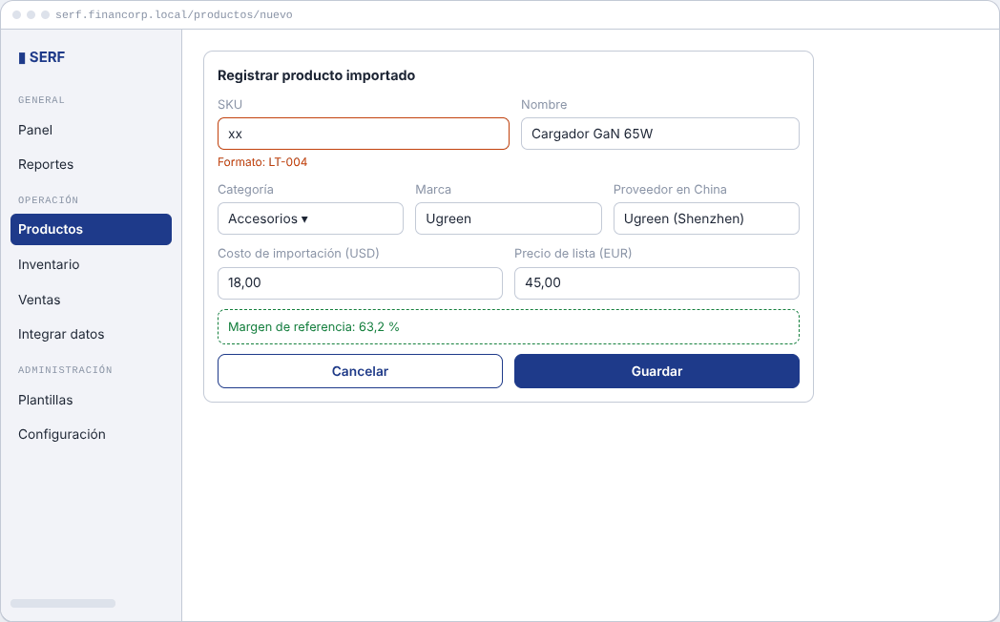 |
| **3. Productos importados** | **4. Registrar producto** |
| 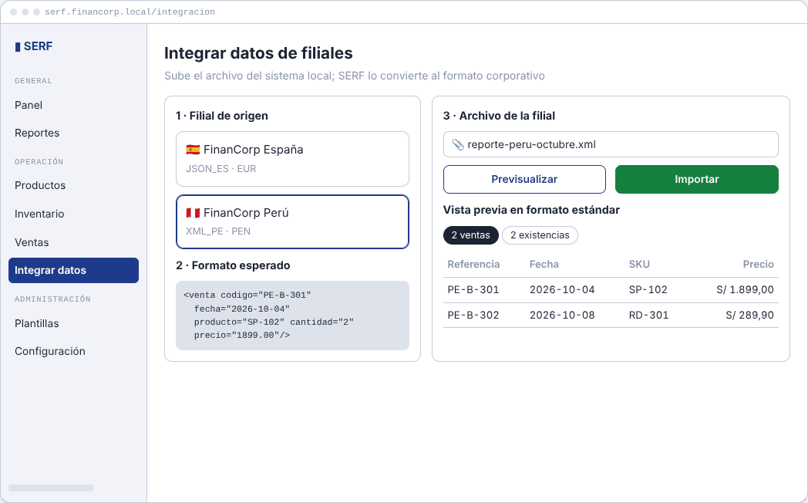 | 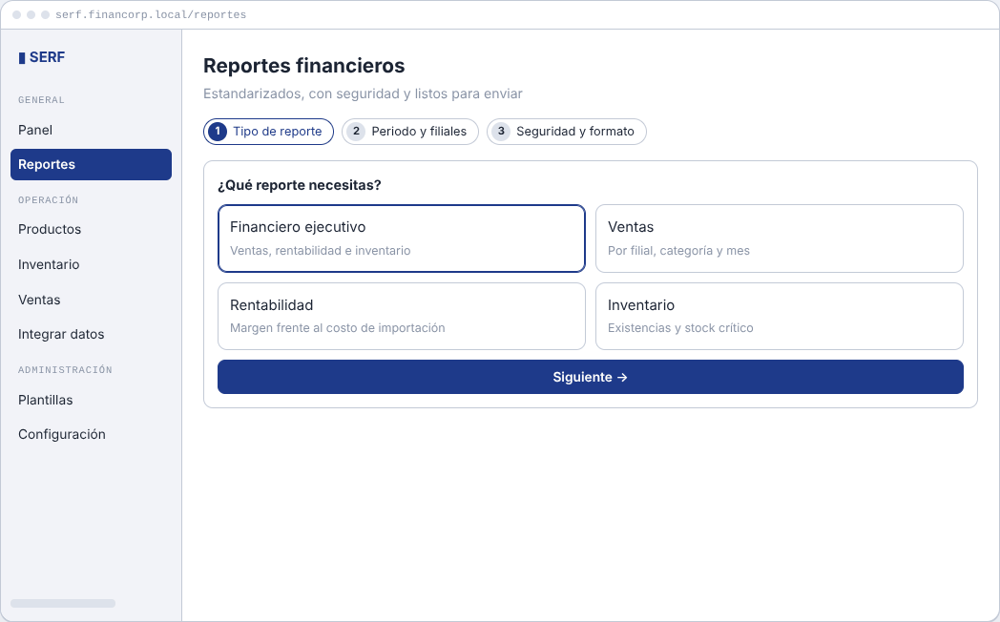 |
| **5. Integrar datos de filial** | **6. Reporte · paso 1 (tipo)** |
| 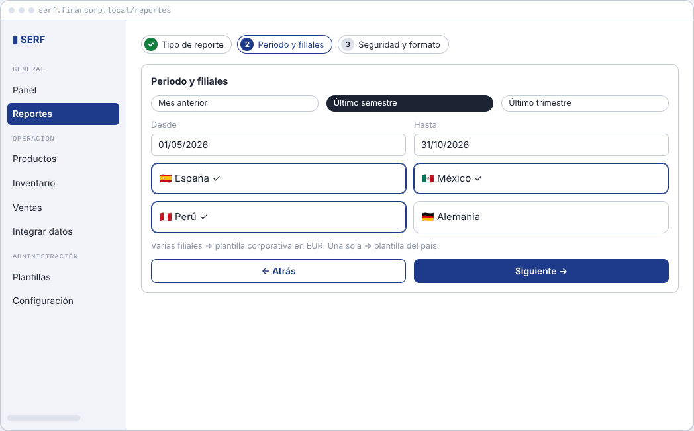 | 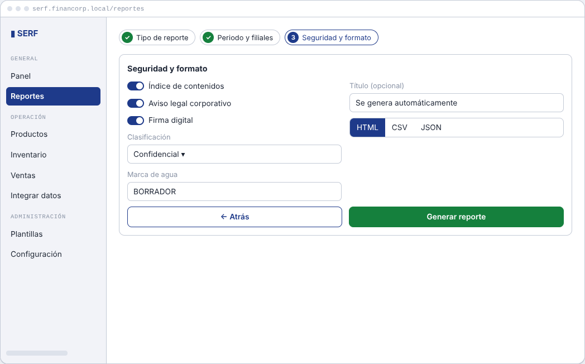 |
| **7. Reporte · paso 2 (periodo y filiales)** | **8. Reporte · paso 3 (seguridad y formato)** |
| 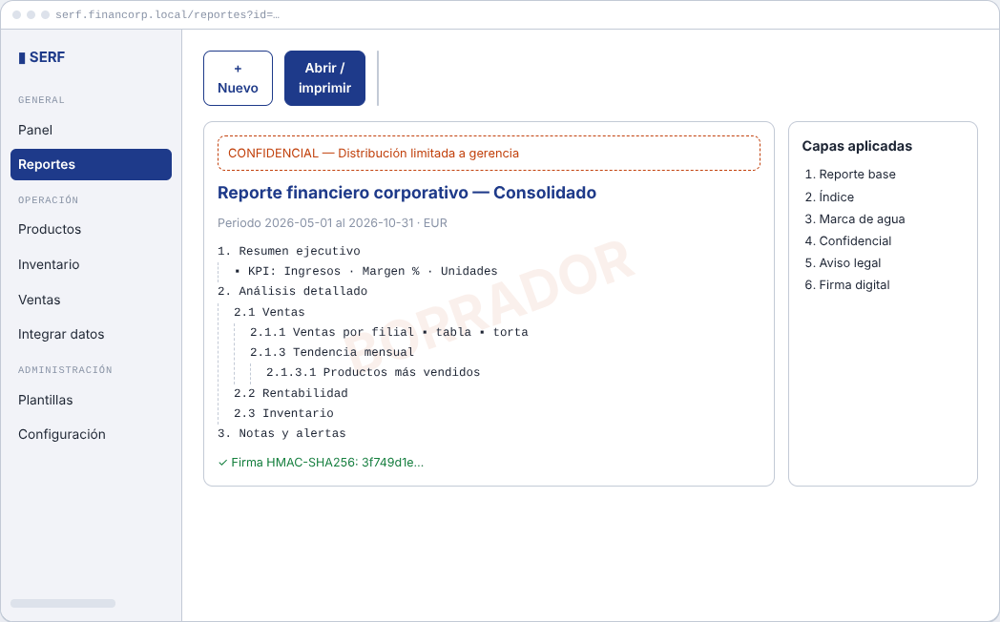 | 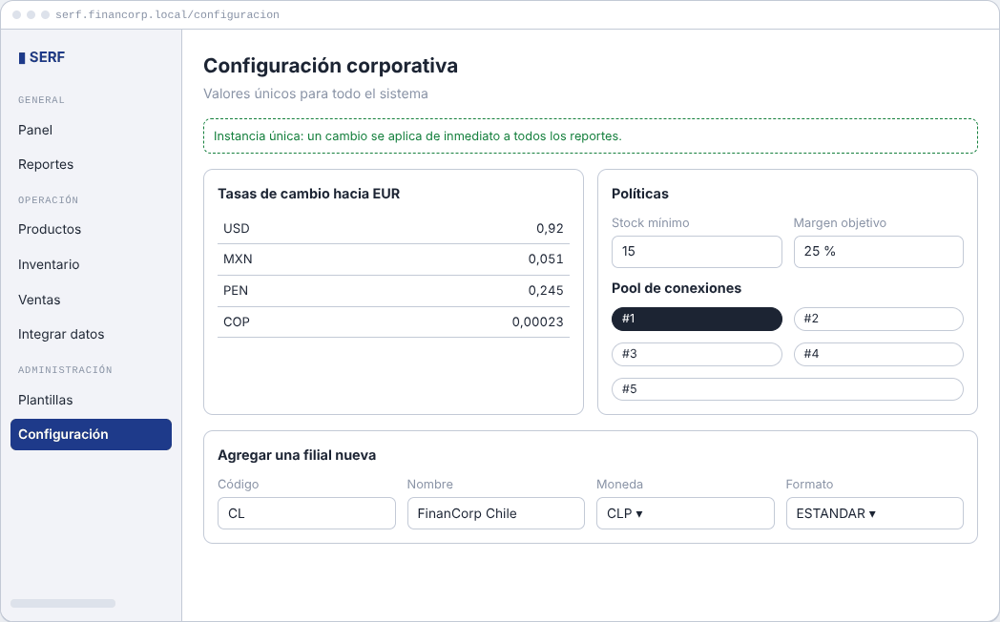 |
| **9. Reporte generado** | **10. Configuración central** |

## Wireframes (móvil)

| | |
|---|---|
| 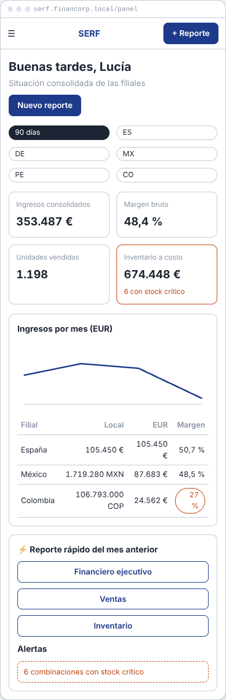 | 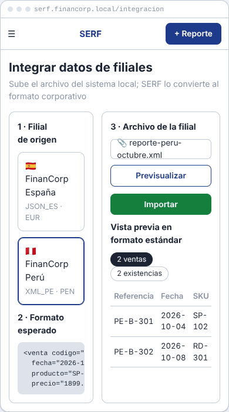 |

## Mapa de navegación

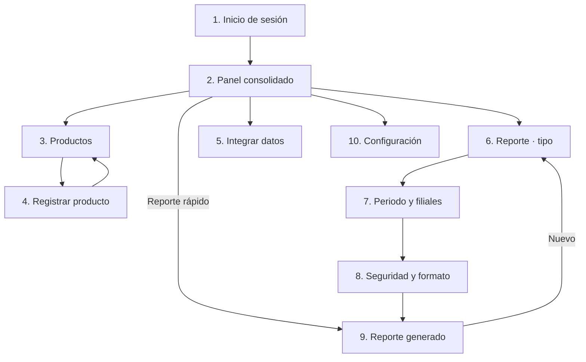

## Decisiones de diseño

- **Barra lateral agrupada** (General, Operación, Administración) en escritorio; menú desplegable y botón "+ Reporte" siempre visible en móvil.
- **El resumen antes que el detalle:** el panel abre con cuatro indicadores y después muestra la tabla por filial.
- **El estado se ve en la forma:** chips rojos para margen bajo, filas rojas para stock crítico y pasos con check en el asistente.
- **Una decisión por pantalla** en el asistente de reportes, con atajos de periodo para el cierre mensual.
- **Vista previa antes de importar**, para revisar cómo se interpretó el archivo de la filial.
- **Paleta corporativa:** azul marino de FinanCorp como acento y colores semánticos (verde, ámbar, rojo) solo para estados.

## Cómo recrear el prototipo en Figma

1. Crea un archivo nuevo en Figma, con un frame **Desktop (1440 × 1024)** por pantalla y uno **iPhone 14 (390 × 844)** para las versiones móviles.
2. Arrastra a cada frame la imagen correspondiente de [`wireframes/`](wireframes/), en el orden 01 → 10.
3. Ve a la pestaña **Prototype** y dibuja conexiones *On click → Navigate to* sobre los botones, siguiendo el mapa de navegación de arriba:
   - Ingresar → Panel
   - Nuevo reporte → Paso 1 → Paso 2 → Paso 3 → Reporte generado
   - Registrar producto → Formulario → Guardar → Productos
4. Marca el frame **01-login** como *Flow starting point*.
5. Pulsa **Share → Copy link** con permiso *can view* y pega el enlace en el documento de sustentación y en el README.
