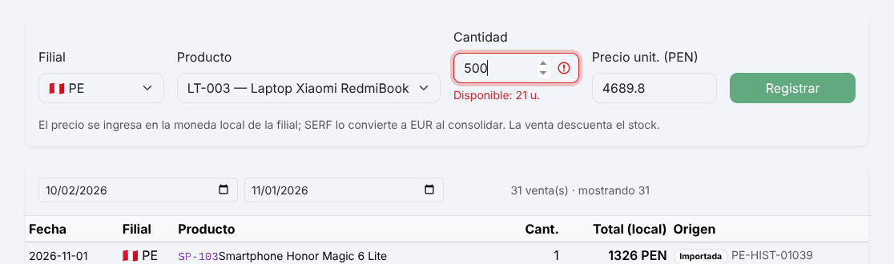
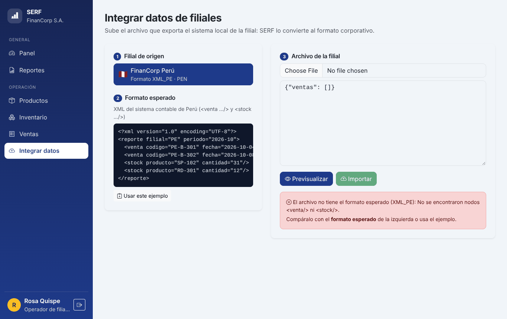

# 03 · Pruebas de usabilidad y mejoras iterativas

## Método

Se hicieron pruebas con **usuarios simulados**. Para cada perfil se definió una tarea realista y se ejecutó sobre la aplicación funcionando, en un navegador automatizado. Se registraron el resultado, el tiempo y el mensaje que vio el usuario, y se revisaron capturas de cada pantalla en escritorio (1440 px) y móvil (390 px). El guion está en `docs/pruebas-usabilidad/usabilidad.mjs`.

| Perfil simulado | Representa a |
|---|---|
| **Lucía** (gerente) | Gerencia corporativa en Madrid; usa escritorio y genera el cierre mensual. |
| **Rosa** (operadora Perú) | Personal de la filial de Lima; registra ventas e integra el archivo de su sistema contable. |
| **Usuario móvil** | Cualquier perfil que consulta desde el celular. |

## Ronda 1: tareas y resultados

| Tarea | Perfil | Resultado | Tiempo |
|---|---|---|---|
| A. Registrar una venta de 500 laptops cuando hay 21 en stock | Rosa | El sistema la rechaza, pero Rosa no sabía cuánto stock había hasta equivocarse. | 4,5 s |
| B. Integrar un archivo con un formato equivocado | Rosa | Se rechaza con el mensaje "No se encontraron nodos `<venta/>`", que es técnico y no dice qué hacer. Además desaparece en unos segundos. | 2,9 s |
| C. Previsualizar un archivo, editarlo y luego importar | Rosa | **Error:** el botón Importar seguía habilitado con la vista previa anterior. | — |
| D. Generar un reporte de otra filial | Rosa | Correcto: solo aparece su filial (Perú). | — |
| E. Poner un periodo invertido en el asistente | Lucía | Correcto: se avisa y no avanza de paso. | — |
| F. Generar el reporte del mes con un clic desde el panel | Lucía | Correcto: reporte firmado y confidencial. | 3,5 s |
| G. Revisar el panel el día 1 del mes | Lucía | El gráfico mensual mostraba una "caída" fuerte que en realidad era el mes recién iniciado. El reporte rápido (mes en curso) salía casi vacío. | — |
| H. Ver el panel en el celular | Móvil | El nombre de la filial se partía en dos líneas, separado de su bandera. | — |
| I. Ver un reporte largo en escritorio | Lucía | La barra lateral dejaba de tener color al bajar en páginas largas. | — |

## Problemas detectados y soluciones aplicadas

| # | Problema | Gravedad | Solución implementada |
|---|---|---|---|
| 1 | La vista previa quedaba obsoleta al editar el archivo (tarea C). | Alta (podía importar datos no revisados). | La vista previa se invalida al cambiar el contenido; hay que volver a previsualizar. |
| 2 | Mensaje de formato técnico y efímero (tarea B). | Media | El backend indica el formato esperado (`El archivo no tiene el formato esperado (XML_PE): …`) y la pantalla lo muestra fijo junto al archivo, con la sugerencia de compararlo con el ejemplo. |
| 3 | No se veía el stock al vender (tarea A). | Media | Se muestra "Disponible: N u." bajo la cantidad; si se excede, el campo se marca en rojo y el botón se deshabilita. |
| 4 | El reporte rápido del mes en curso salía vacío a inicio de mes (tarea G). | Media | El reporte rápido usa el **último mes completo**, que coincide con el cierre mensual. |
| 5 | El mes en curso parecía una caída de ventas (tarea G). | Baja | El último punto del gráfico se etiqueta "(en curso)". |
| 6 | El nombre de la filial se partía en móvil (tarea H). | Baja | La celda no permite salto de línea; la tabla se desplaza horizontalmente. |
| 7 | La barra lateral se cortaba en páginas largas (tarea I). | Baja | El fondo de la barra se extiende a todo el alto de la página. |

## Ronda 2: verificación

Se repitieron las tareas A, B y C después de los cambios:

| Tarea | Resultado tras la mejora |
|---|---|
| A | Se muestra "Disponible: 21 u." y el botón Registrar queda deshabilitado al pedir 500. |
| B | Mensaje fijo: "El archivo no tiene el formato esperado (XML_PE): … Compáralo con el formato esperado de la izquierda o usa el ejemplo." |
| C | Al editar el archivo, el botón Importar se deshabilita hasta volver a previsualizar. |

| Stock visible al vender | Error de formato comprensible |
|---|---|
|  |  |

Estas mejoras están en el commit `fix(ux): mejoras tras las pruebas de usabilidad` del historial del repositorio.
